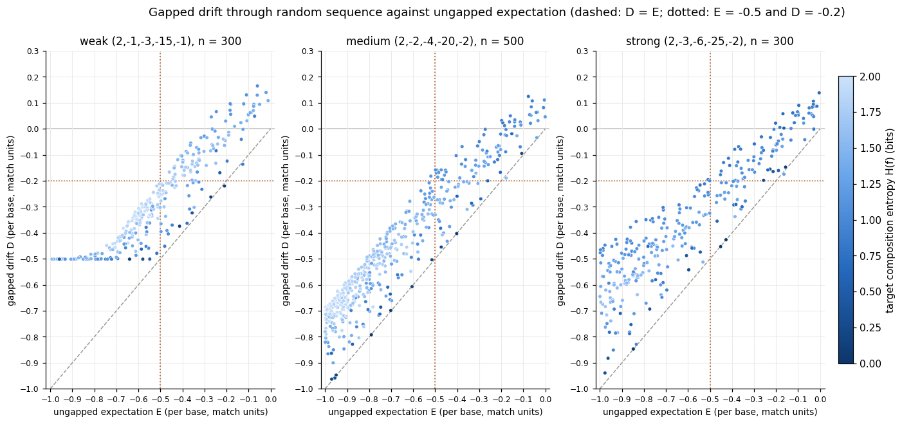
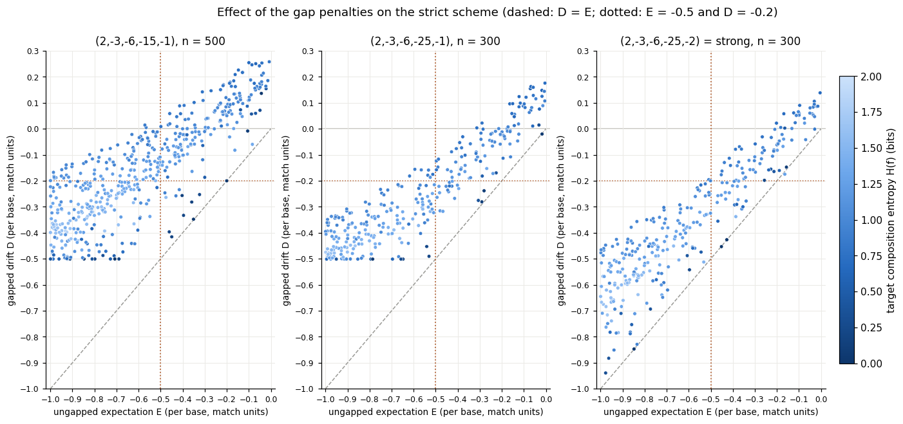

# satscan: hierarchical scoring

This note explains why `satscan` uses three scoring schemes by default, how it decides which one to use where, and the simulations that the choices are based on.  For how to run `satscan`, see the [README](README.md#satscan).

## The problem: matches due to composition

A scoring scheme is only safe for local alignment if the expected score of aligning unrelated sequences is negative.  Then the score of a chance alignment drifts downwards and chance matches stay short.  With uniform base composition all the schemes used here are safe, but a satellite unit is often strongly biased in composition, and genomes contain long regions of biased composition too.  If a purine-rich unit is aligned against purine-rich sequence, most mismatches are transitions, which are penalised only lightly, and the expected score can become positive.  The alignment then grows through unrelated sequence.

Weaker scoring schemes find more divergent satellite arrays, but are more exposed to this.  `satscan` therefore uses a weak scheme where it is safe and switches to stricter schemes only in the regions where the weak one is not.

## Expected score and gapped drift

For a unit with base counts nb (length N = Σb nb) and a score matrix s(a,b), the expected score of target base a against a random position in the unit is

&nbsp;&nbsp;&nbsp;&nbsp;ca = Σb (nb/N) s(a,b),

and the expected ungapped score per aligned base in a region with base composition f is

&nbsp;&nbsp;&nbsp;&nbsp;E(f) = Σa fa ca.

E is linear in f.  Scores are given here in match units, i.e. divided by the match score, so that schemes with different match scores can be compared; all three `satscan` schemes have a match score of 2, so −0.5 in match units is −1 in score units.  Some examples for the weak scheme (2, −1, −3), with the target composition equal to the unit's:

| Composition | E (match units) |
|---|---|
| uniform | −0.625 |
| 80% A+T | −0.49 |
| 100% A+T | −0.25 |
| 70% A, 10% each of C, G, T | −0.03 |
| 100% purine (A and G) | +0.25 |

AT bias alone is fairly safe, because A↔T mismatches are transversions, which carry the heavier penalty.  The dangerous compositions are purine-rich or pyrimidine-rich ones, and those dominated by a single base.

E ignores gaps, and gaps let an alignment do better than E by sliding around mismatches.  What matters for chance matches is the gapped drift D: the average change per base in the score of the best gapped path through unrelated sequence.  D cannot fall below gapExtend divided by the match score (−0.5 for weak with gapExtend −1, −1.0 for medium and strong with gapExtend −2), since a single long gap through the sequence costs only that much per base.

### Simulations

D was measured with `satscan`'s own dynamic programming, so that every detail of its recursion is included.  For each trial a random unit of length 20 to 600bp was drawn from composition q, and a target was made of a perfect array of the unit (about 6kb), then 5 or 10kb of random sequence of composition f, then another perfect array.  With the x-drop switched off, the reported score is the two arrays' known scores plus the score of the best path through the random stretch, which gives D.  The compositions q and f were drawn from Dirichlet distributions with α between 0.2 and 3, so as to cover both near-uniform and extreme compositions, with f = q in 40% of trials, and the trials were rejection-sampled to give E between −1 and 0 in match units.

Each point is one trial, coloured by the entropy of the target composition, H(f) = −Σa fa log2 fa, which runs from 0 bits for a single base to 2 bits for uniform composition.  Points lie above the dashed line D = E, by up to about 0.3: that is the gain from gaps.  Near-pure compositions (dark points) gain little, since with a single base every offset scores the same, while compositions dominated by two bases gain most.

| Scheme | Lowest E with D > −0.25 | with D > −0.10 | with D > 0 | Highest D with E ≤ −0.5 |
|---|---|---|---|---|
| weak (2,−1,−3,−15,−1) | −0.53 | −0.38 | −0.27 | −0.21 |
| medium (2,−2,−4,−20,−2) | −0.57 | −0.38 | −0.20 | −0.18 |
| strong (2,−3,−6,−25,−2) | −0.56 | −0.39 | −0.20 | −0.20 |

All E and D values are in match units per base.

### The decision point

`satscan` treats a region as dangerous for a scheme if E > −0.5 in match units, which is −1 per base in score units.  In the simulations, wherever E ≤ −0.5 the gapped drift was at most about −0.2 per base for all three schemes, so a chance extension loses at least 0.2 match units per base.  The same threshold serves all three schemes.

### Gap penalties for the strict schemes

The first strict scheme tried, (2,−3,−6,−15,−1), had harsher mismatch penalties but the weak scheme's gaps.  It gained much more from gaps than the weak scheme did: some trials had D > 0 at E = −0.57, and D > −0.25 even at E = −1.  Because a mismatch costs 3 or 6 but opening a gap only 15, sliding around mismatches with short gaps is relatively cheap.  Raising the gap open penalty to −25 brought the points down a long way, and a gap extend of −2 then tightened them into a narrow band like the weak scheme's.  Medium is the same in this respect: with gap extend −1 its highest D for E ≤ −0.5 was −0.11, and with −2 it is −0.18.

## Why three schemes rather than two

A stricter scheme is also less sensitive to real, divergent arrays.  On the human genome used in the README example, the unit sat-2-25 has 34 matches covering 16.6Mb, at about 70% identity, in a block on chrY (29.2 to 56.6Mb) that is flagged as dangerous for the weak scheme.  The strong scheme finds only 9 matches of at most 100bp there, because at 70% identity its expected score per aligned base is about zero before gaps.  The medium scheme keeps all 16.6Mb, and 99% of the unit's coverage genome-wide.  The flagged regions there only just exceed the threshold, with E for the weak scheme at −0.499.  For them, medium is −0.85 and strong −1.43 match units, so strong is far stricter than needed.  The hierarchy uses the least strict scheme that is safe in each region.

## How the masking works

For each query unit and strand (the reverse complement of the unit has the complementary composition), each scheme s and each target sequence:

1. **Weights.**  Each target base a gets the integer weight Wa = Σb nb s(a,b) + N, which is N(ca − T) with T = −1 per base in score units.  A region has positive mean weight exactly when E > T there.  Because the weights are integers the segment sums are exact.
2. **Whole sequence.**  If the target sequence's own composition already gives a non-negative mean weight, the whole sequence is dangerous for that scheme.  If no weight is positive, nothing is.
3. **Segments.**  Otherwise the dangerous regions are the maximal-scoring segments of W along the sequence, found in one pass by the reset-at-zero method used for ungapped high-scoring segments: keep a running sum, reset it when it falls to zero, and keep each excursion's best segment.  A segment is kept if its score is at least S* = ln(108)/λ, where λ > 0 solves Σa ga eλWa = 1 for the sequence's composition g, and if it is at least max(64, unit length) long.  By the Karlin–Altschul result, S* gives about one chance segment per 100Mb if the sequence were random with composition g; the minimum length excludes regions too short to hold the 32bp start and end windows of a match.
4. **Nesting.**  Regions are found for the weak scheme first, then for medium only inside the weak regions, then for strong only inside the medium regions.  This is sound because each scheme's weights are no larger than the previous one's.
5. **Levels.**  Each target position is scanned with the weak scheme unless it lies in a weak region, with medium if it lies in a weak but not a medium region, and with strong if it lies in a medium but not a strong region.  In a strong region no match may start, and any match reaching it ends there.

The dynamic programming looks up the score table for the scheme at each target position, as does the scoring of the 32bp start and end windows, so a window or a match that crosses a region boundary is scored base by base with the right scheme.  This costs almost nothing: on the human genome with 12 units the run took 184 seconds against 180 with the weak scheme everywhere.  Ns in the target are read as A, as they are for the alignment.

Each reported match lists the schemes it used, and `satscan` reports on stderr the number and total length of the regions at each level for each unit and strand.  `-score` replaces the hierarchy with a single scheme used everywhere, with no masking.

## Results on human

The 12 satellite units of `mHomSap-sat.fa`, scanned against the human genome with the default hierarchical scoring, and with the weak scheme everywhere (`-score 2,-1,-3,-15,-1`), using the same x-drop:

| Unit | Strand | Weak everywhere: matches | Mb | Hierarchical: matches | Mb | Weak's coverage kept |
|---|---|---|---|---|---|---|
| sat-8-20 | + | 90,086 | 4.45 | 2,639 | 0.11 | 2.5% |
| sat-8-20 | − | 98,392 | 6.55 | 3,158 | 0.21 | 3.2% |
| sat-1-42 | + | 2,487 | 12.63 | 75 | 11.29 | 89.4% |
| sat-1-42 | − | 2,716 | 3.08 | 59 | 2.16 | 70.0% |
| sat-2-25 | + | 507 | 41.81 | 558 | 41.68 | 99.7% |
| sat-2-25 | − | 502 | 56.28 | 532 | 56.20 | 99.9% |
| other 9 units | both | | | | | 100% |
| all | both | 196,963 | 239.5 | 9,294 | 203.4 | |

The hierarchical scheme found nothing that weak everywhere missed.  Nearly all of the reduction is for sat-8-20, which is (GAGGG)4, a purely purine pentamer; most of its matches with the weak scheme everywhere are short matches to purine-rich sequence.  sat-1-42, which is 81% A+T, loses about 2,400 short matches per strand and keeps most of its length; whether the 1–2Mb it loses includes real arrays has not yet been checked.  sat-8-20 is also the only unit with regions where no scheme is safe, about 2.3 to 2.5Mb per strand.

## Limitations

- The threshold S* assumes the sequence is random with its overall composition.  Real genomes vary in composition from region to region and contain low-complexity runs, so many more segments pass S* than the 1 per 100Mb it is set for.  Those are real regions of biased composition, which is what is wanted, but the rate should not be read as a false positive rate.
- The model uses single-base composition.  The expected score of a target base against a random position in the unit depends only on base frequencies, so a dinucleotide model would give the same E.  What it does not capture is that an alignment chooses its best offset: a periodic, low-complexity target can align well in phase with a unit containing similar motifs.  Such matches, e.g. (GA)n sequence to a GA-rich unit, are arguably genuine low-complexity tandem repeats.
- The thresholds come from simulations of i.i.d. random sequence.  They do not cover sequence with internal structure, such as other repeats.
